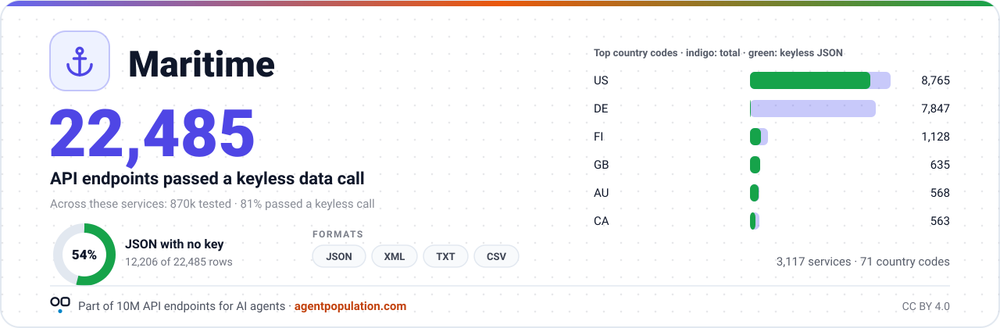
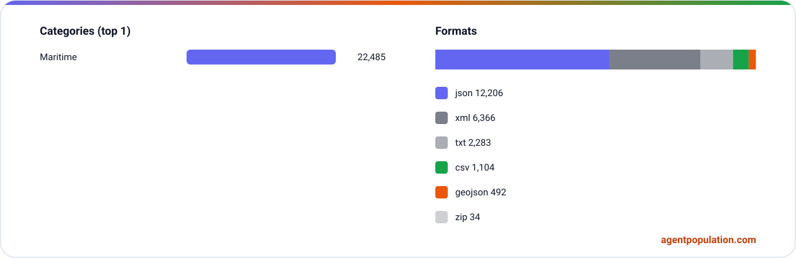

<p align="center"></p>

# ⚓ Maritime API endpoints

**22,485 maritime API endpoints that answered a keyless GET with a data body. For agent and app builders.**

<p align="center"><a href="#files"></a> <a href="#columns-and-tags"></a> <a href="#whats-inside"></a> <a href="#whats-inside"></a> <a href="LICENSE"></a></p>

<p align="center"><a href="#whats-in-it-for-you">What's in it</a> · <a href="#for-ai-agents">For AI agents</a> · <a href="#quick-start">Quick start</a> · <a href="#test-it-yourself">Test it yourself</a> · <a href="#files">Files</a> · <a href="#licence-and-credit">Licence</a> · <a href="#part-of-10m-api-endpoints-for-ai-agents">More packs</a></p>

This repository holds a 1,000-row sample and the services list; the full list of 22,485 endpoints is one download from the [latest release](https://github.com/agentpopulation/22k-maritime-apis-for-agents/releases/latest).

**Endpoints for building a ship, port or harbour tool.** Port calls by port code, port, harbour and ferry map layers (many of them on ArcGIS Online), nautical chart features, ship traffic density, maritime freight and inland shipping statistics, and seawater and sediment files from the German maritime agency, as URLs that answered with no key on their test date. Many rows do not name a ship, port, ferry or harbour in the title; Known limits counts them.

Selection rule: rows where `category is "Maritime"`, less the rows that a leave-out rule drops (each counted under Known limits).

7,177 of these 22,485 rows match the focus rule (below); the others are in the pack by the selection rule only, and Known limits says what they are. 8,809 rows (39.2%) are map layers on ArcGIS Online, where anyone can publish.

## In plain words

**What is an API endpoint?** An API endpoint is one web address that a program can ask for data, for example the latest reading at one weather station. A single service, such as a national weather agency, can have thousands of endpoints: one per station, city or dataset. This pack counts endpoints, not separate services.

**What does "passed a data call" mean?** On the date shown in each row, AgentPopulation sent one plain request to that address, with no password or key, and got a non-empty data body back (JSON, CSV, XML or a file): not an error page and not an empty result. Some bodies describe a dataset rather than hold its values; see Known limits. It shows the address answered with data on that day. It is not a promise that it answers today, and licences and usage limits were not reviewed.

## What's in it for you

Four ways to use this pack. Each bucket gives a count, a filter you can apply to the CSV, one example that passed, and a list of recommended starting points with the rule that picked them. Buckets overlap; a row can fit more than one.

Examples, recommended lists and the preview are drawn from rows that match this pack's focus rule, so a row that the selection rule put in this pack but that is about something else is not shown as a starting point. Counts cover the whole bucket.

<details>
<summary>The focus rule</summary>

Focus rule: `(title matches /(^|[^a-zäöüß])(ports?|harbou?rs?|ferr(y|ies)|ferryboats?|ships?|shipping|vessels?|boats?|marinas?|maritime|nautical|navigation|navigational|seaports?|wharf|wharves|piers?|docks?|berths?|anchorages?|lighthouses?|shipwrecks?|wrecks?|cargo|freight|tankers?|cruise|fleet|locode|ais|waterways?|canals?|moorings?|fairways?|seafarers?|schiff\w*|hafen\w*|häfen|fähr\w*|seefahrt|liegepl\w*|havn|hamn|puertos?|porto|bacs?)([^a-zäöüß]|$)/i AND NOT title matches /harbou?r (seals?|porpoises?)|harbor mall|\b(gig|grays|bar|stone|ybor|old|sag|boothbay|benton) harbou?r\b|\bport (orange|lincoln|st\.? ?lucie|arthur|aransas|royal|angeles|townsend|huron|charlotte|hueneme|macquarie|moody|alberni|richey|neches|hedland|pirie|wentworth)\b|\b(bonners|lees|harpers) ferry\b|port harcourt|charente-maritime|portes ouvertes|charging|harbor mountain|storm ?(water|drain)|shipping updates|go-ship|rail freight|street tree|statistical district/i) AND NOT url contains "/erddap/info/" AND NOT host is erddap.sensors.ioos.us`

</details>

### 🤖 Agent tools: Port calls, harbour limits and chart features an agent can query

**4,326** endpoints from 1,311 services · Wrap the port-call URL as a get_port_calls tool: pass a UN/LOCODE port code (FIHEL), return the ships with arrival and departure times; add a timeout.

3,186 of these are map-layer queries that asked for a few records (`resultRecordCount`); raise it or page through for the whole layer.

Start with: `tags has agent-ready AND NOT url contains "/erddap/info/" AND (title matches /(^|[^a-zäöüß])(ports?|harbou?rs?|ferr(y|ies)|ferryboats?|ships?|shipping|vessels?|boats?|marinas?|maritime|nautical|navigation|navigational|seaports?|wharf|wharves|piers?|docks?|berths?|anchorages?|lighthouses?|shipwrecks?|wrecks?|cargo|freight|tankers?|cruise|fleet|locode|ais|waterways?|canals?|moorings?|fairways?|seafarers?|schiff\w*|hafen\w*|häfen|fähr\w*|seefahrt|liegepl\w*|havn|hamn|puertos?|porto|bacs?)([^a-zäöüß]|$)/i AND NOT title matches /harbou?r (seals?|porpoises?)|harbor mall|\b(gig|grays|bar|stone|ybor|old|sag|boothbay|benton) harbou?r\b|\bport (orange|lincoln|st\.? ?lucie|arthur|aransas|royal|angeles|townsend|huron|charlotte|hueneme|macquarie|moody|alberni|richey|neches|hedland|pirie|wentworth)\b|\b(bonners|lees|harpers) ferry\b|port harcourt|charente-maritime|portes ouvertes|charging|harbor mountain|storm ?(water|drain)|shipping updates|go-ship|rail freight|street tree|statistical district/i)`

Example: [Digitraffic port calls: Helsinki (Helsingfors)](https://meri.digitraffic.fi/api/port-call/v1/port-calls?locode=FIHEL) · Digitraffic · passed 2026-11-14

<details>
<summary>Recommended starting points: 8 services, picked by the stated criteria inside</summary>

**Recommended starting points.** Selected by stated criteria, not a ranking of quality: Services in this pack with the most endpoints that match this bucket and are tagged `agent-ready` (no key sent in the test call, JSON body, passed a data call). Ties go to the service with more country codes, then by name. Only services with at least one bucket row that matches the focus rule are listed, and the sample comes from those rows; the counts cover the whole bucket. The sample URL is the first row by URL sort after preferring, in this order: rows that match the bucket's sample preference when it has one, rows that return values rather than describe a dataset or a service (not ERDDAP /info/ pages, OGC GetCapabilities requests, bare OWS addresses, PxWeb tables, UN SDG series lists, Statistics Canada download pointers, WorldPop listings, GTFS validation reports, untitled rows or service root addresses), and agent-ready rows. Sample preference in this bucket: `url contains "port-calls?locode=FIHEL" OR host is encdirect.noaa.gov`. Services named "ArcGIS organization" hold map layers from many owners and are added only when fewer than 5 other services match.

| Service (host) | Endpoints in bucket | In pack | Country codes in bucket | Formats in bucket | Sample URL that passed |
|---|---:|---:|---|---|---|
| Digitraffic (meri.digitraffic.fi) | 695 | 1,121 | FI | json | [Digitraffic port calls: Helsinki (Helsi…](https://meri.digitraffic.fi/api/port-call/v1/port-calls?locode=FIHEL) (2026-11-14) |
| Compute 1 (AWS) (ec2-50-19-218-171.compute-1.amazonaws.com) | 96 | 96 | global or unknown | json | [Administrative / 200NM EEZ and Maritime…](http://ec2-50-19-218-171.compute-1.amazonaws.com/arcgis1/rest/services/Administrative/MapServer/9/query?where=1%3D1&outFields=*&resultRecordCount=10&f=json) (2026-11-15) |
| Northeastoceandata (devservices.northeastoceandata.org) | 96 | 96 | global or unknown | json | [Administrative / 200NM EEZ and Maritime…](https://devservices.northeastoceandata.org/neoddev/rest/services/Administrative/MapServer/7/query?where=1%3D1&outFields=*&resultRecordCount=10&f=json) (2026-11-15) |
| GIS WebTech (ArcGIS Online) (services6.arcgis.com) | 66 | 73 | US | json | [Aberdeen Port Industrial Park- property…](https://services6.arcgis.com/BAJNi3EgCdtQ1BCG/arcgis/rest/services/Aberdeen%20Port%20Industrial%20ParkProperty%20Outline%20Publish185/FeatureServer/0/query?where=1%3D1&outFields=*&returnGeometry=false&resultRecordCount=5&f=json) (2026-11-14) |
| Open Data Portal / Queensland Government (data.qld.gov.au) | 47 | 129 | AU | json | [Recreational ships registered](https://data.qld.gov.au/api/3/action/datastore_search?resource_id=03d61d9c-d399-478f-9ed3-0c57f002c027&limit=1) (2026-11-15) |
| Doi (doi.org) | 46 | 188 | global or unknown | json | [MODFLOW-2000 model used to evaluate alt…](https://doi.org/10.5066/F70G3J3J) (2026-11-15) |
| Hong Kong Open Data Portal (www.censtatd.gov.hk) | 33 | 33 | HK | json | [Hong Kong Shipping Statistics - Table 4…](https://www.censtatd.gov.hk/api/get.php?id=410-55110&lang=en&full_series=1) (2026-11-15) |
| Ecan (gis.ecan.govt.nz) | 30 | 40 | US | json | [Maritime Markers](https://gis.ecan.govt.nz/arcgis/rest/services/Public/Harbours/MapServer/0/query?where=1%3D1&outFields=*&returnGeometry=false&resultRecordCount=5&f=json) (2026-11-14) |

</details>

### 📱 App features: Port, ferry, mooring and harbour maps

**4,349** endpoints from 1,332 services · Show ports, ferry piers, moorings and harbour limits on a coastal map card, with the layer name and the date it passed.

Start with: `(tags has maps OR format in (geojson, csv)) AND NOT url contains "/erddap/" AND NOT tags has statistics AND NOT host in (gdi.bsh.de, ec.europa.eu, genesis.destatis.de) AND (title matches /(^|[^a-zäöüß])(ports?|harbou?rs?|ferr(y|ies)|ferryboats?|ships?|shipping|vessels?|boats?|marinas?|maritime|nautical|navigation|navigational|seaports?|wharf|wharves|piers?|docks?|berths?|anchorages?|lighthouses?|shipwrecks?|wrecks?|cargo|freight|tankers?|cruise|fleet|locode|ais|waterways?|canals?|moorings?|fairways?|seafarers?|schiff\w*|hafen\w*|häfen|fähr\w*|seefahrt|liegepl\w*|havn|hamn|puertos?|porto|bacs?)([^a-zäöüß]|$)/i AND NOT title matches /harbou?r (seals?|porpoises?)|harbor mall|\b(gig|grays|bar|stone|ybor|old|sag|boothbay|benton) harbou?r\b|\bport (orange|lincoln|st\.? ?lucie|arthur|aransas|royal|angeles|townsend|huron|charlotte|hueneme|macquarie|moody|alberni|richey|neches|hedland|pirie|wentworth)\b|\b(bonners|lees|harpers) ferry\b|port harcourt|charente-maritime|portes ouvertes|charging|harbor mountain|storm ?(water|drain)|shipping updates|go-ship|rail freight|street tree|statistical district/i)`

Example: [Fintraffic Digitraffic: AIS last position: LIFEGU…](https://meri.digitraffic.fi/api/ais/v1/locations?mmsi=111265582) · Digitraffic · passed 2026-11-15

<details>
<summary>Recommended starting points: 8 services, picked by the stated criteria inside</summary>

**Recommended starting points.** Selected by stated criteria, not a ranking of quality: Services in this pack with the most endpoints that match this bucket and passed a data call. Ties go to the service with more country codes, then by name. Only services with at least one bucket row that matches the focus rule are listed, and the sample comes from those rows; the counts cover the whole bucket. The sample URL is the first row by URL sort after preferring, in this order: rows that match the bucket's sample preference when it has one, rows that return values rather than describe a dataset or a service (not ERDDAP /info/ pages, OGC GetCapabilities requests, bare OWS addresses, PxWeb tables, UN SDG series lists, Statistics Canada download pointers, WorldPop listings, GTFS validation reports, untitled rows or service root addresses), and agent-ready rows. Sample preference in this bucket: `NOT url matches ///(services[0-9]*(-[a-z0-9]+)?|utility)\.arcgis\.com//i AND (format is geojson OR host is encdirect.noaa.gov OR title matches /ferry|mooring|berth|harbour limits|port facilit/i)`. Services named "ArcGIS organization" hold map layers from many owners and are added only when fewer than 5 other services match.

| Service (host) | Endpoints in bucket | In pack | Country codes in bucket | Formats in bucket | Sample URL that passed |
|---|---:|---:|---|---|---|
| Digitraffic (meri.digitraffic.fi) | 426 | 1,121 | FI | geojson | [Fintraffic Digitraffic: AIS last positi…](https://meri.digitraffic.fi/api/ais/v1/locations?mmsi=111265582) (2026-11-15) |
| Transparenzportal Hamburg (archiv.transparenz.hamburg.de) | 182 | 232 | DE | xml | [Hafengebietsgrenzen Hamburg - Dienst "W…](https://archiv.transparenz.hamburg.de/hmbtgarchive/HMDK/hh_wfs_hafengebietsgrenzen_119437_snap_1.XML) (2026-11-15) |
| Noaa (data.ngdc.noaa.gov) | 97 | 115 | US | csv | [D00127: NOS Hydrographic Survey , Key W…](https://data.ngdc.noaa.gov/platforms/ocean/nos/coast/D00001-D02000/D00127/GEODAS/D00127.a93.gz) (2026-11-15) |
| Compute 1 (AWS) (ec2-50-19-218-171.compute-1.amazonaws.com) | 96 | 96 | global or unknown | json | [Administrative / 200NM EEZ and Maritime…](http://ec2-50-19-218-171.compute-1.amazonaws.com/arcgis1/rest/services/Administrative/MapServer/9/query?where=1%3D1&outFields=*&resultRecordCount=10&f=json) (2026-11-15) |
| Northeastoceandata (devservices.northeastoceandata.org) | 96 | 96 | global or unknown | json | [Administrative / 200NM EEZ and Maritime…](https://devservices.northeastoceandata.org/neoddev/rest/services/Administrative/MapServer/7/query?where=1%3D1&outFields=*&resultRecordCount=10&f=json) (2026-11-15) |
| GIS WebTech (ArcGIS Online) (services6.arcgis.com) | 66 | 73 | US | json | [Aberdeen Port Industrial Park- property…](https://services6.arcgis.com/BAJNi3EgCdtQ1BCG/arcgis/rest/services/Aberdeen%20Port%20Industrial%20ParkProperty%20Outline%20Publish185/FeatureServer/0/query?where=1%3D1&outFields=*&returnGeometry=false&resultRecordCount=5&f=json) (2026-11-14) |
| Canadian Urban Data Catalogue (CUDC) (api-proxy.edh-cde.dfo-mpo.gc.ca) | 43 | 83 | CA | csv | [Underwater video analysis data of the c…](https://api-proxy.edh-cde.dfo-mpo.gc.ca/catalogue/records/044e733f-7560-422b-b8ab-046218f92160/attachments/Dictionnaire_de_donnees_data_dictionary_BDISM.csv) (2026-11-15) |
| Ecan (gis.ecan.govt.nz) | 30 | 40 | US | json | [Swing Moorings](https://gis.ecan.govt.nz/arcgis/rest/services/Public/Harbours/MapServer/1/query?where=1%3D1&outFields=*&returnGeometry=false&resultRecordCount=5&f=json) (2026-11-14) |

</details>

### 🧠 Grounding and data pipelines: Maritime freight, port traffic and inland shipping tables for scheduled loads

**1,390** endpoints from 117 services · Load freight, port-call and ship-count tables on a schedule into your own store, so answers about port traffic cite a dated table.

Start with: `format in (csv, txt, xml, zip) AND (title matches /(^|[^a-zäöüß])(ports?|harbou?rs?|ferr(y|ies)|ferryboats?|ships?|shipping|vessels?|boats?|marinas?|maritime|nautical|navigation|navigational|seaports?|wharf|wharves|piers?|docks?|berths?|anchorages?|lighthouses?|shipwrecks?|wrecks?|cargo|freight|tankers?|cruise|fleet|locode|ais|waterways?|canals?|moorings?|fairways?|seafarers?|schiff\w*|hafen\w*|häfen|fähr\w*|seefahrt|liegepl\w*|havn|hamn|puertos?|porto|bacs?)([^a-zäöüß]|$)/i AND NOT title matches /harbou?r (seals?|porpoises?)|harbor mall|\b(gig|grays|bar|stone|ybor|old|sag|boothbay|benton) harbou?r\b|\bport (orange|lincoln|st\.? ?lucie|arthur|aransas|royal|angeles|townsend|huron|charlotte|hueneme|macquarie|moody|alberni|richey|neches|hedland|pirie|wentworth)\b|\b(bonners|lees|harpers) ferry\b|port harcourt|charente-maritime|portes ouvertes|charging|harbor mountain|storm ?(water|drain)|shipping updates|go-ship|rail freight|street tree|statistical district/i) AND NOT host is gdi.bsh.de AND NOT url contains "/erddap/"`

Example: [R/V San Lorenzo (receive vessel) navigation and s…](https://data.usgs.gov/datacatalog/metadata/USGS.4b08628c-f376-4813-b700-d5ab33ec6082.xml) · Usgs · passed 2026-11-15

<details>
<summary>Recommended starting points: 8 services, picked by the stated criteria inside</summary>

**Recommended starting points.** Selected by stated criteria, not a ranking of quality: Services in this pack with the most endpoints that match this bucket and passed a data call. Ties go to the service with more country codes, then by name. Only services with at least one bucket row that matches the focus rule are listed, and the sample comes from those rows; the counts cover the whole bucket. The sample URL is the first row by URL sort after preferring, in this order: rows that match the bucket's sample preference when it has one, rows that return values rather than describe a dataset or a service (not ERDDAP /info/ pages, OGC GetCapabilities requests, bare OWS addresses, PxWeb tables, UN SDG series lists, Statistics Canada download pointers, WorldPop listings, GTFS validation reports, untitled rows or service root addresses), and agent-ready rows. Sample preference in this bucket: `NOT url matches ///(services[0-9]*(-[a-z0-9]+)?|utility)\.arcgis\.com//i AND title matches /maritime|seaborne|ships by|vessels?|inland waterway|port of|passengers|cargo/i`. Services named "ArcGIS organization" hold map layers from many owners and are added only when fewer than 5 other services match.

| Service (host) | Endpoints in bucket | In pack | Country codes in bucket | Formats in bucket | Sample URL that passed |
|---|---:|---:|---|---|---|
| Usgs (data.usgs.gov) | 340 | 988 | US | xml | [R/V San Lorenzo (receive vessel) naviga…](https://data.usgs.gov/datacatalog/metadata/USGS.4b08628c-f376-4813-b700-d5ab33ec6082.xml) (2026-11-15) |
| Transparenzportal Hamburg (archiv.transparenz.hamburg.de) | 182 | 232 | DE | xml | [Hafengebietsgrenzen Hamburg - Dienst "W…](https://archiv.transparenz.hamburg.de/hmbtgarchive/HMDK/hh_wfs_hafengebietsgrenzen_119437_snap_1.XML) (2026-11-15) |
| Eurostat dissemination API (ec.europa.eu) | 165 | 198 | EU | csv, txt | [Number of ships of 1000 GT and over by …](https://ec.europa.eu/eurostat/api/dissemination/sdmx/2.1/data/enps_mar_eq1000?format=SDMX-CSV&compressed=true) (2026-11-14) |
| Noaa (data.ngdc.noaa.gov) | 101 | 115 | US | csv, xml | [F00640: NOS Hydrographic Survey , Port …](https://data.ngdc.noaa.gov/platforms/ocean/nos/coast/F00001-F02000/F00640/DR/F00640_DR.xml) (2026-11-15) |
| Destatis GENESIS (Germany) (genesis.destatis.de) | 73 | 97 | DE | xml, txt | [Companies, turnover, personnel, ships (…](https://genesis.destatis.de/genesisWS/downloads/00/tables/46311-0001_00.csv) (2026-11-14) |
| Canadian Urban Data Catalogue (CUDC) (api-proxy.edh-cde.dfo-mpo.gc.ca) | 46 | 83 | CA | csv, txt | [Underwater video analysis data of the c…](https://api-proxy.edh-cde.dfo-mpo.gc.ca/catalogue/records/044e733f-7560-422b-b8ab-046218f92160/attachments/Dictionnaire_de_donnees_data_dictionary_BDISM.csv) (2026-11-15) |
| Canadian Urban Data Catalogue (CUDC) (data.novascotia.ca) | 25 | 47 | CA | csv | [Ferry Schedules - Ferry Schedules (CSV)](https://data.novascotia.ca/api/views/7izn-s679/rows.csv?accessType=DOWNLOAD) (2026-11-15) |
| Lacity (data.lacity.org) | 24 | 48 | US | xml, csv, zip | [Port of Los Angeles Fire and Police Sta…](https://data.lacity.org/api/geospatial/az58-m5hh?method=export&format=KML) (2026-11-15) |

</details>

### 🧪 Evals and testing: Port calls, layers and tables to test a maritime tool

**22,485** endpoints · 3,117 services · 71 country codes · 6 formats · Run your maritime tool against a fixed set of URLs across formats; check that port code, ship name, time or feature geometry parse, and keep last_tested as the baseline for your own re-tests.

Start with: the whole pack

Example: [Digitraffic port calls: Helsinki (Helsingfors)](https://meri.digitraffic.fi/api/port-call/v1/port-calls?locode=FIHEL) · Digitraffic · passed 2026-11-14

<details>
<summary>Recommended starting points: 8 services, picked by the stated criteria inside</summary>

**Recommended starting points.** Selected by stated criteria, not a ranking of quality: Services in this pack that returned the most different formats, then the most endpoints that passed a data call, then by name: a mix of response shapes to test parsers and tool calls. Only services with at least one bucket row that matches the focus rule are listed, and the sample comes from those rows; the counts cover the whole bucket. The sample URL is the first row by URL sort after preferring, in this order: rows that match the bucket's sample preference when it has one, rows that return values rather than describe a dataset or a service (not ERDDAP /info/ pages, OGC GetCapabilities requests, bare OWS addresses, PxWeb tables, UN SDG series lists, Statistics Canada download pointers, WorldPop listings, GTFS validation reports, untitled rows or service root addresses), and agent-ready rows. Sample preference in this bucket: `NOT url matches ///(services[0-9]*(-[a-z0-9]+)?|utility)\.arcgis\.com//i AND (url contains "port-calls?locode=FIHEL" OR format is geojson)`. Services named "ArcGIS organization" hold map layers from many owners and are added only when fewer than 5 other services match.

| Service (host) | Endpoints in bucket | In pack | Country codes in bucket | Formats in bucket | Sample URL that passed |
|---|---:|---:|---|---|---|
| geo.sv.rostock.de | 54 | 54 | DE | xml, csv, geojson, json, txt | [Ferry piers](https://geo.sv.rostock.de/download/opendata/faehranleger/faehranleger.json) (2026-11-14) |
| Open Development Mekong Datahub (data.opendevelopmentmekong.net) | 32 | 32 | KH, MM | csv, json, geojson, xml, zip | [Harbor and port of Vietnam - Harbor\_eng…](https://data.opendevelopmentmekong.net/vi/dataset/35aa1dff-a427-442f-b057-e71a71dc1eb9/resource/b5b1678c-0762-4196-8149-7ca041c6277d/download/harborgeojson.geojson) (2026-11-15) |
| BSH geospatial data (Germany) (gdi.bsh.de) | 7,278 | 7,278 | DE | xml, txt, csv, json | [Verkehrsnetze (Schifffahrtswege)](https://gdi.bsh.de/de/data/Transport-Networks-Water-Transport-Network.json) (2026-11-15) |
| Lacity (data.lacity.org) | 48 | 48 | US | json, xml, csv, zip | [Port of Los Angeles - Emission from Por…](https://data.lacity.org/api/views/2t3h-my34/rows.json?accessType=DOWNLOAD) (2026-11-15) |
| ArcGIS Online: Blue Whiting Spawning & Nursery Grounds (msp-opendata-marineplan.hub.arcgis.com) | 41 | 41 | IE | xml, csv, geojson, json | [Fishing Port](https://msp-opendata-marineplan.hub.arcgis.com/api/download/v1/items/0e1db49350304b1ca681e5f8db520c06/geojson?layers=0) (2026-11-14) |
| data.gov.au (opendata.transport.nsw.gov.au) | 39 | 39 | AU | json, csv, txt, geojson | [Maritime NSW Coastal Bar - Maritime NSW…](https://opendata.transport.nsw.gov.au/data/dataset/9a170f05-801a-4a21-abfe-8ac8d2b3bcac/resource/35ae9f78-540e-4c24-8a8a-6e6e80360f2b/download/maritime_coastal_bar.geojson) (2026-11-15) |
| ArcGIS Online: Baronies (data-osi.opendata.arcgis.com) | 15 | 15 | IE | csv, json, zip, geojson | [Ferry Crossing - National 250k Map Of I…](https://data-osi.opendata.arcgis.com/api/download/v1/items/77d633054056487180918ac9053684fc/geojson?layers=0) (2026-11-14) |
| Transparenzportal Hamburg (archiv.transparenz.hamburg.de) | 232 | 232 | DE | xml, json, zip | [Hafengebietsgrenzen Hamburg - Dienst "W…](https://archiv.transparenz.hamburg.de/hmbtgarchive/HMDK/hh_wfs_hafengebietsgrenzen_119437_snap_1.XML) (2026-11-15) |

</details>

The same lists are in [recommended.json](recommended.json), ready for an agent to load.

## Questions an agent can answer with this pack

- Which ships have called at a Finnish port, and when did they arrive and leave? Try [Digitraffic port calls: Helsinki (Helsingfors)](https://meri.digitraffic.fi/api/port-call/v1/port-calls?locode=FIHEL) (Digitraffic, passed 2026-11-14).
- How much freight did maritime transport move in each NUTS 2 region? Try [Maritime transport of freight by NUTS 2 region](https://ec.europa.eu/eurostat/api/dissemination/sdmx/2.1/data/tgs00076?format=SDMX-CSV&compressed=true) (Eurostat dissemination API, passed 2026-11-14).
- Which harbor facilities does a NOAA approach and harbor chart layer show? Try [Harbor Facility Polygon - Approach/Harbor](https://encdirect.noaa.gov/arcgis/rest/services/encdirect/enc_approach/MapServer/184/query?where=1%3D1&outFields=*&returnGeometry=false&resultRecordCount=5&f=json) (Noaa, passed 2026-11-14).
- Where are the ship moorings in Rostock? Try [Ship moorings](https://geo.sv.rostock.de/download/opendata/schiffsliegeplaetze/schiffsliegeplaetze.csv) (geo.sv.rostock.de, passed 2026-11-14).

## What "passed a data call" means

> [!NOTE]
> On the date in `last_tested` (IST), one GET to the URL, sent with no key, returned HTTP 2xx and a non-empty data body. HTML pages and empty results did not pass. The `format` column records what came back. This is a test result for that date, not a promise that the URL answers today. Licences, terms, rate limits, accuracy and freshness were not reviewed. Endpoints are URLs, not separate APIs; many share one service. This pack was tested 10–15 Nov 2026; snapshot 15 Nov 2026.

## For AI agents

Start from keyless JSON endpoints (`agent-ready`). The code below loads `recommended.json` and calls the first recommended service in the Agent tools bucket, with a timeout (`node examples/agent-start.mjs --recommended`). With no argument, `node examples/agent-start.mjs` calls the most recently tested agent-ready row of the sample; pass a `.csv` or `.csv.gz` path to use that file instead. See [examples/agent-start.mjs](examples/agent-start.mjs).

```js
// Node 18+. Loads recommended.json (the local copy, or the raw file on GitHub) and calls one keyless JSON endpoint.
import fs from 'node:fs';

const RAW = 'https://raw.githubusercontent.com/agentpopulation/22k-maritime-apis-for-agents/main/recommended.json';
const rec = fs.existsSync('recommended.json')
  ? JSON.parse(fs.readFileSync('recommended.json', 'utf8'))
  : await (await fetch(RAW)).json();

const pick = rec.buckets.find((b) => b.id === 'agent').services[0];
try {
  const res = await fetch(pick.sample_url, {
    headers: { 'User-Agent': 'agent-example/1.0' },
    signal: AbortSignal.timeout(15000),
  });
  console.log(pick.service, res.status, res.headers.get('content-type'));
  console.log((await res.text()).slice(0, 300));
} catch (err) {
  console.log(`did not answer now; last passed ${pick.sample_last_tested} (${err.message})`);
}
```

How an agent picks an endpoint:

1. Filter to `agent-ready` and your country or topic.
2. Prefer the newest `last_tested` and the larger services.
3. Call with a timeout and check the body before you use it.

## Quick start

The examples run against the sample in `data/` out of the box (1,000 rows). Each takes an optional path to a `.csv` or `.csv.gz` file instead.

```bash
git clone https://github.com/agentpopulation/22k-maritime-apis-for-agents.git
cd 22k-maritime-apis-for-agents
python examples/quickstart.py
node examples/quickstart.mjs
node examples/agent-start.mjs
```

Full list: download `Maritime_API_Endpoints_AgentPopulation_Snapshot_2026-11-15.csv.gz` (22,485 rows, 1.1 MB) from [releases/latest](https://github.com/agentpopulation/22k-maritime-apis-for-agents/releases/latest), then gunzip it and pass its path. The scripts also read the `.csv.gz` as it is.

```bash
gunzip Maritime_API_Endpoints_AgentPopulation_Snapshot_2026-11-15.csv.gz
python examples/quickstart.py Maritime_API_Endpoints_AgentPopulation_Snapshot_2026-11-15.csv
node examples/quickstart.mjs Maritime_API_Endpoints_AgentPopulation_Snapshot_2026-11-15.csv
```

### curl

Quote the URL: some contain commas.

```bash
curl -sL "https://raw.githubusercontent.com/agentpopulation/22k-maritime-apis-for-agents/main/data/Maritime_API_Endpoints_AgentPopulation_Sample.csv" | head -n 4
curl -s --max-time 15 "https://meri.digitraffic.fi/api/port-call/v1/port-calls?locode=FIHEL" | head -c 600
```

### Python

Standard library only: [examples/quickstart.py](examples/quickstart.py) reads the sample, or the path you pass, keeps agent-ready rows and calls the most recently tested one.

<details>
<summary>The code</summary>

```python
# Python 3, standard library only. Run from a clone of this repository:
#   python examples/quickstart.py [path]
# With no path it reads the sample in data/. Pass the full list from the latest release (.csv or .csv.gz) instead.
# Keeps agent-ready rows and calls the most recently tested one.
import csv
import gzip
import os
import re
import sys
import urllib.request

HERE = os.path.dirname(os.path.abspath(__file__))
path = sys.argv[1] if len(sys.argv) > 1 else os.path.join(HERE, "..", "data", "Maritime_API_Endpoints_AgentPopulation_Sample.csv")
opener = gzip.open if path.endswith(".gz") else open
with opener(path, "rt", newline="", encoding="utf-8") as f:
    rows = list(csv.DictReader(f))

agent = [r for r in rows if "agent-ready" in r["tags"].split("|")]
# Newest test date first; URLs that describe a dataset or a service rather than return values go last.
DESCRIBES = re.compile(r"/erddap/info/|action-report\.json$|[?&]request=getcapabilities|/GeoArea/[^/?]+/List|getFullTableDownloadCSV|hub\.worldpop\.org", re.I)
agent.sort(key=lambda r: r["last_tested"], reverse=True)
agent.sort(key=lambda r: 1 if DESCRIBES.search(r["url"]) else 0)
print(len(rows), "rows,", len(agent), "agent-ready")
if not agent:
    sys.exit(0)

row = agent[0]
req = urllib.request.Request(row["url"], headers={"User-Agent": "agent-example/1.0"})
try:
    with urllib.request.urlopen(req, timeout=15) as res:
        body = res.read(1_000_000).decode("utf-8", "replace")
        print(res.status, res.headers.get("Content-Type"))
        print(body[:300])
except Exception as err:
    print(f"did not answer now; last passed {row['last_tested']} ({err})")
```

</details>

### JavaScript

Reads the sample as JSON because the CSV has quoted commas.

<details>
<summary>The code</summary>

```js
// Node 18+. Reads the sample as JSON (the CSV has quoted commas), local file first.
import fs from 'node:fs';

const FILE = 'data/Maritime_API_Endpoints_AgentPopulation_Sample.json';
const rows = fs.existsSync(FILE)
  ? JSON.parse(fs.readFileSync(FILE, 'utf8'))
  : await (await fetch('https://raw.githubusercontent.com/agentpopulation/22k-maritime-apis-for-agents/main/data/Maritime_API_Endpoints_AgentPopulation_Sample.json')).json();

const row = rows.find((r) => r.tags.includes('agent-ready'));
const res = await fetch(row.url, { headers: { 'User-Agent': 'agent-example/1.0' }, signal: AbortSignal.timeout(15000) });
console.log(res.status, (await res.text()).slice(0, 300));
```

</details>

### Agent tools

[examples/agent-tools.json](examples/agent-tools.json) holds two tool definitions in the shape most tool-calling APIs accept (name, description, JSON Schema); rename `parameters` if yours uses another key. [examples/quickstart.mjs](examples/quickstart.mjs) implements them:

- `find_endpoints` searches the agent-ready rows of the list by words, country code (their format is json). When you load the tools of more than one pack, prefix the names (for example `maritime_find_endpoints`) so they do not clash.
- `fetch_endpoint` calls one URL, **refuses any URL that is not in the list** and does not follow redirects. The allowlist is built from the CSV, so a URL injected into a prompt is refused.

The same two tools can sit behind an MCP server.

## Test it yourself

Re-test endpoints from the sample with the same rule: HTTP 2xx and a non-empty body that is not an HTML page. Node 18+, no packages.

```bash
node tools/test-endpoints.mjs
```

It tests the first 50 URLs and prints one line: tested, passed, did not pass. Options: a `.csv` or `.csv.gz` path (the full list from the release), `--limit 50`, `--timeout-ms 10000`, `--out results.csv`. The results file holds `url`, `status`, `passed`, `content_type`, `ms` and `checked_at`; a status of `timeout` or `error:<code>` means no HTTP answer came back. It is polite: GET only, no key sent, at most 4 requests in flight, one at a time per listed host, at least 1 second between requests to one listed host, and reading stops once 256 kB of a body is kept. Redirects are followed and may lead to another host. `results.csv` is in `.gitignore`.

## Preview

One row from each of the five largest services among rows that match the focus rule, services with rows that return values first.

| Title | Service | Country | Format | Tested | Link |
|---|---|---|---|---|---|
| Fintraffic Digitraffic: AIS vessel metadata: LIFEGUARD 002 … | Digitraffic | FI | json | 2026-11-15 | [meri.digitraffic.fi](https://meri.digitraffic.fi/api/ais/v1/vessels/111265582) |
| Verkehrsnetze (Schifffahrtswege) | BSH geospatial data (Germany) | DE | json | 2026-11-15 | [gdi.bsh.de](https://gdi.bsh.de/de/data/Transport-Networks-Water-Transport-Network.json) |
| Raw HYPACK navigation logs (text) collected by the U.S. Geo… | Usgs | US | xml | 2026-11-15 | [data.usgs.gov](https://data.usgs.gov/datacatalog/metadata/USGS.0000a76f-c6be-4366-8be3-6f8487442e8a.xml) |
| Hafengebietsgrenzen Hamburg - Dienst "WFS Hafengebietsgrenz… | Transparenzportal Hamburg | DE | xml | 2026-11-15 | [archiv.transparenz.hamburg.de](https://archiv.transparenz.hamburg.de/hmbtgarchive/HMDK/hh_wfs_hafengebietsgrenzen_119437_snap_1.XML) |
| Number of ships of 1000 GT and over by type of vessel - ENP… | Eurostat dissemination API | EU | txt | 2026-11-14 | [ec.europa.eu](https://ec.europa.eu/eurostat/api/dissemination/sdmx/2.1/data/enps_mar_eq1000?format=SDMX-CSV&compressed=true) |

Browse the 1,000-row sample: [Sample CSV](data/Maritime_API_Endpoints_AgentPopulation_Sample.csv) · [Sample JSON](data/Maritime_API_Endpoints_AgentPopulation_Sample.json).

## What's inside

<p align="center"></p>

<details>
<summary>Country codes: 71</summary>

| Code | Country | Endpoints | |
|---|---|---:|---|
| US | United States | 8,765 | `████████████████████` |
| DE | Germany | 7,847 | `█████████████████▉` |
| FI | Finland | 1,128 | `██▋` |
| GB | United Kingdom | 635 | `█▌` |
| AU | Australia | 568 | `█▎` |
| CA | Canada | 563 | `█▎` |
| FR | France | 430 | `█` |
| EU | European Union | 232 | `▌` |
| IE | Ireland | 229 | `▌` |
| NZ | New Zealand | 190 | `▍` |
| | other 61 codes | 927 | |
| | global or unknown | 971 | `██▎` |

</details>

<details>
<summary>Categories: top 1</summary>

| Category | Endpoints | |
|---|---:|---|
| Maritime | 22,485 | `████████████████████` |

</details>

Formats: json 12,206 · xml 6,366 · txt 2,283 · csv 1,104 · geojson 492 · zip 34

<details>
<summary>Largest services: top 25 of 3,117</summary>

| Service | Host | Endpoints | Keyless JSON | |
|---|---|---:|---:|---|
| BSH geospatial data (Germany) | gdi.bsh.de | 7,278 | 8 | `████████████████████` |
| Digitraffic | meri.digitraffic.fi | 1,121 | 695 | `███▏` |
| Usgs | data.usgs.gov | 988 | 0 | `██▊` |
| Transparenzportal Hamburg | archiv.transparenz.hamburg.de | 232 | 1 | `▋` |
| Eurostat dissemination API | ec.europa.eu | 198 | 0 | `▌` |
| Doi | doi.org | 188 | 188 | `▌` |
| BrisMAP Public (ArcGIS Online) | services2.arcgis.com | 129 | 129 | `▍` |
| Open Data Portal / Queensland Government | data.qld.gov.au | 129 | 129 | `▍` |
| Noaa | data.ngdc.noaa.gov | 115 | 0 | `▍` |
| vector.sitg.ge.ch † | vector.sitg.ge.ch | 115 | 115 | `▍` |
| ArcGIS Online layers (services8.arcgis.com, org V9zL6jzLdVCgrx6S) | services8.arcgis.com | 99 | 99 | `▎` |
| Cioosatlantic † | cioosatlantic.ca | 98 | 98 | `▎` |
| Municipality of Anchorage (ArcGIS Online) | services2.arcgis.com | 98 | 98 | `▎` |
| Destatis GENESIS (Germany) | genesis.destatis.de | 97 | 0 | `▎` |
| Compute 1 (AWS) | ec2-50-19-218-171.compute-1.amazonaws.com | 96 | 96 | `▎` |
| Northeastoceandata | devservices.northeastoceandata.org | 96 | 96 | `▎` |
| NOAA GeoPlatform (ArcGIS Online) | services2.arcgis.com | 91 | 91 | `▎` |
| Ioos † | atn.ioos.us | 90 | 90 | `▎` |
| ArcGIS Online layers (services.arcgis.com, org jDGuO8tYggdCCnUJ) | services.arcgis.com | 86 | 86 | `▎` |
| gis.dnr.wa.gov † | gis.dnr.wa.gov | 86 | 86 | `▎` |
| Canadian Urban Data Catalogue (CUDC) | api-proxy.edh-cde.dfo-mpo.gc.ca | 83 | 0 | `▎` |
| ArcGIS Online layers (services3.arcgis.com, org VL3y0UFwNNVn5BNL) † | services3.arcgis.com | 79 | 79 | `▎` |
| GIS WebTech (ArcGIS Online) | services6.arcgis.com | 73 | 73 | `▎` |
| ArcGIS Online layers (services5.arcgis.com, org UVHSpElsHQnwNCps) † | services5.arcgis.com | 71 | 71 | `▎` |
| ArcGIS Online layers (services-eu1.arcgis.com, org Nt9PzCzX9tz2k5Lq) | services-eu1.arcgis.com | 58 | 58 | `▏` |

† No row of these services matches the focus rule: the selection rule put them in this pack, so they are not used as a starting point.

</details>

<details>
<summary>Rows per test date: 10–15 Nov 2026</summary>

| Date (IST) | Endpoints | |
|---|---:|---|
| 2026-11-15 | 6,842 | `████████▊` |
| 2026-11-14 | 15,642 | `████████████████████` |
| 2026-11-10 | 1 | `▏` |

</details>

## Files

| File | Rows | Size | Use |
|---|---:|---:|---|
| [data/Maritime_API_Services_AgentPopulation.csv](data/Maritime_API_Services_AgentPopulation.csv) | 3,117 | 191.7 kB | One row per service with its endpoint count in this pack |
| [data/Maritime_API_Endpoints_AgentPopulation_Sample.csv](data/Maritime_API_Endpoints_AgentPopulation_Sample.csv) | 1,000 | 309.0 kB | The sample: focus-rule rows first, each service in proportion to its share; ArcGIS Online layers count as one service |
| [data/Maritime_API_Endpoints_AgentPopulation_Sample.json](data/Maritime_API_Endpoints_AgentPopulation_Sample.json) | 1,000 | 504.4 kB | The same rows as JSON, tags as an array |
| [Maritime_API_Endpoints_AgentPopulation_Snapshot_2026-11-15.csv.gz](https://github.com/agentpopulation/22k-maritime-apis-for-agents/releases/latest) | 22,485 | 1.1 MB | The full list, gzipped CSV: a download from the latest release, checked by `SHA256SUMS.txt` |
| [tools/test-endpoints.mjs](tools/test-endpoints.mjs) | | | Re-tests endpoints from the sample or the full list |

Sample size: 1,000 rows, which is 1,000 or one third of the pack rounded down, whichever is smaller. Rows that match the focus rule come first. Each service gets rows in proportion to its share of those rows, at least one for the largest services and at most 50% of the sample while other services have rows; ArcGIS Online layers count as one service, whatever their organisation. Within a service, agent-ready rows, rows that return values and the newest test dates come first, and rows are written in turn across services. Service root addresses are placed at the end of the sample.

Full list: download `Maritime_API_Endpoints_AgentPopulation_Snapshot_2026-11-15.csv.gz` (22,485 rows, 1.1 MB) from [releases/latest](https://github.com/agentpopulation/22k-maritime-apis-for-agents/releases/latest), then gunzip it and pass its path. The scripts also read the `.csv.gz` as it is.

Excel users: Data > From Text/CSV, UTF-8. Files are UTF-8 without a byte-order mark and comma-separated.

## Columns and tags

<details>
<summary>Columns, types and tags</summary>

| Column | Type | Example | Meaning |
|---|---|---|---|
| url | string | [https://meri.digitraffic.fi/api/ais/v1/…](https://meri.digitraffic.fi/api/ais/v1/vessels/111265582) | The address that was tested |
| title | string | Fintraffic Digitraffic: AIS vessel meta… | Station, dataset or feed name |
| service | string | Digitraffic | The service the endpoint belongs to; joins to the services file together with host |
| host | string | meri.digitraffic.fi | Host name of the address |
| country | string | FI | ISO 3166-1 alpha-2 code, or EU; empty when global or unknown |
| category | string | Maritime | Category of the endpoint |
| subcategory | string |  | Left empty from the 15 Nov 2026 snapshot; kept so the columns stay the same |
| format | string | json | What the test call returned: json, csv, geojson, xml, gtfs, zip, txt and so on |
| tags | string | `maritime\|oceans\|traffic\|no-key\|json\|age…` | Tags separated by \| |
| last_tested | date | 2026-11-15 | Date of the test call, YYYY-MM-DD (IST) |

| Tag | Rows | Meaning |
|---|---:|---|
| maritime | 22,485 | Topic tag |
| no-key | 22,485 | No key was sent in the test call |
| agent-ready | 12,206 | No key sent, JSON body, passed a data call on last_tested |
| json | 12,206 | Format of the body |
| maps | 10,943 | Topic tag |
| xml | 6,366 | Format of the body |
| open-data | 3,514 | Topic tag |
| oceans | 2,459 | Topic tag |
| traffic | 1,301 | Topic tag |
| csv | 1,104 | Format of the body |
| environment | 1,072 | Topic tag |
| geojson | 492 | Format of the body |
| statistics | 449 | Topic tag |
| transit | 445 | Topic tag |
| rivers | 432 | Topic tag |
| government | 421 | Topic tag |
| weather | 343 | Topic tag |
| science | 317 | Topic tag |
| tides | 195 | Topic tag |
| air-quality | 122 | Topic tag |
| earthquakes | 109 | Topic tag |
| elevation | 105 | Topic tag |
| parking | 58 | Topic tag |
| hazards | 57 | Topic tag |
| health | 54 | Topic tag |
| economy | 45 | Topic tag |
| floods | 45 | Topic tag |
| finance | 43 | Topic tag |
| energy | 42 | Topic tag |
| climate | 26 | Topic tag |
| tsunami | 23 | Topic tag |
| groundwater | 19 | Topic tag |
| aviation | 14 | Topic tag |
| forecast | 9 | Topic tag |
| geocoding | 5 | Topic tag |
| wildfire | 4 | Topic tag |
| gtfs | 3 | GTFS feed |
| volcanoes | 3 | Topic tag |
| ai-ml | 1 | Topic tag |

A machine-readable copy of this dictionary is in [datapackage.json](datapackage.json).

</details>

## Known limits

- 39.0% of rows carry country code US; 971 rows have no code (global or unknown).
- 353 rows are ERDDAP /info/ pages: they describe a dataset rather than return its values, so the series needs a second request.
- 10,295 rows are map-layer queries with resultRecordCount set: the tested call asked for a few records; change the query to get the full layer.
- 206 rows carry limit=1: the tested call asked for one record; raise the limit or page through.
- 2,317 rows are files (zip 34, txt 2,283) rather than bodies an agent reads directly.
- 8,809 rows are layers on ArcGIS Online, where anyone can publish: some are class projects, tests or copies. Check the owner and the fields before you rely on one.
- 14,758 rows have no ship, port, ferry, harbour or navigation term in the title. Check the title before you use one; they are not used as starting points.
- 6,306 rows are seawater, sediment, wave, current and echo-sounder files from the German maritime agency (BSH) for the North Sea and Baltic: marine data, not ships or ports.
- 4,969 rows are ArcGIS map layers filed under port, harbor or ferry with no such term in the title; many are local layers such as roads, drains or district boundaries.
- 403 rows match a port, harbour or shipping word only through a name or another meaning (harbour seals and porpoises, places such as Port Harcourt, Gig Harbor, Port Orange or Bonners Ferry, Charente-Maritime, charging ports, storm drains, map files with shipping updates, rail freight).
- 84 rows from New Zealand hosts (.nz) carry country code US in this snapshot; filter by host when you need New Zealand only.
- 12 rows from Canadian hosts (.ca) carry country code US in this snapshot; filter by host when you need Canada only.
- Stations and feeds can go quiet after their test date; re-test a URL before you rely on it.
- Not in this pack: endpoints that need a key or a POST, and URLs that did not pass.
- Left out: 4 rows with an email-like address.
- Left out: 235 ArcGIS Survey123 layers (they can hold people's form answers).
- Left out: 1 layer marked editable in the title (it can hold entries that people added).
- Left out: 23 ArcGIS layers that keep a form's default service name (they can hold people's form answers).
- Left out: 140 ArcGIS class or coursework layers (lab, assignment, exam, quiz, lesson, exercise, tutorial and final-project layers, copies of class layers, layers named for a person or a person's home, and layers whose name ends in a person's name or holds a student number).
- Left out: 18 ArcGIS layers that hold reports, comments, submissions or form responses sent in by the public.
- Left out: 4 ArcGIS layers that are records about named people (employee, patient, client or donor lists, home addresses, voter lists, sex offender and missing person layers).
- Left out: 4 rows of ArcGIS Online organisations that are class accounts (25 layers or more, at least 50% of them class or coursework layers): their other layers are students' work too.
- Left out: 583 rows of ArcGIS Online organisations that are class accounts (3 class sets or more in at least 20% of their rows, 10 class sets or more with no organisation name, or layers signed by students read by hand): their other layers are students' work too.
- Left out: 39 rows of class sets: one map layer saved under 5 or more students' initials or names in one ArcGIS Online organisation, or in 4 or more students' own organisations.
- Left out: 1,662 rows of the ArcGIS Online organisations of universities, colleges and schools (many of their layers are students' work).
- Left out: 23 rows that repeat an address already in the pack.

## Licence and credit

> [!IMPORTANT]
> This list (URLs, titles, tags and test results) is © 2026 AgentPopulation, released under [CC BY 4.0](https://creativecommons.org/licenses/by/4.0/). Credit AgentPopulation and link agentpopulation.com. The data each endpoint returns belongs to its provider and stays under that provider's terms; this licence does not cover it.

Copy-ready credit:

`Maritime API endpoints by AgentPopulation (https://agentpopulation.com), CC BY 4.0, snapshot 15 Nov 2026.`

GitHub's "Cite this repository" button reads [CITATION.cff](CITATION.cff).

<!-- agentpopulation:start -->
## Part of 10M API endpoints for AI agents

This pack is one of the 50 topic packs of [10m-open-apis-for-ai-agents](https://github.com/agentpopulation/10m-open-apis-for-ai-agents), the open collection by [AgentPopulation](https://agentpopulation.com). Target: 10 million+ open API endpoints that pass a keyless API call.

AgentPopulation has tested over 5 million API endpoints: 5,129,834 tested, 3,726,509 passed a data call (snapshot 15 Nov 2026). This is the maritime pack: 22,485 endpoints from 3,117 services. Packs overlap, so an endpoint can appear in more than one.

For the latest tested endpoints, search [agentpopulation.com/apis](https://agentpopulation.com/apis). This pack is a snapshot from 15 Nov 2026.

Sibling packs that share the most URLs with this one: [2.2m-agent-ready-apis](https://github.com/agentpopulation/2.2m-agent-ready-apis) (12,188 shared) · [260k-water-apis-for-agents](https://github.com/agentpopulation/260k-water-apis-for-agents) (3,039 shared) · [84k-oceans-apis-for-agents](https://github.com/agentpopulation/84k-oceans-apis-for-agents) (2,461 shared) · [240k-transit-apis-for-agents](https://github.com/agentpopulation/240k-transit-apis-for-agents) (1,836 shared) · [22k-traffic-apis-for-agents](https://github.com/agentpopulation/22k-traffic-apis-for-agents) (1,293 shared) · [170k-weather-apis-for-agents](https://github.com/agentpopulation/170k-weather-apis-for-agents) (468 shared). The rest are listed in [10m-open-apis-for-ai-agents](https://github.com/agentpopulation/10m-open-apis-for-ai-agents).

Questions, pack requests, reports of endpoints that stopped answering and requests to remove a row go to [Discussions](https://github.com/agentpopulation/10m-open-apis-for-ai-agents/discussions), or to [@agentpopulation](https://x.com/agentpopulation) on X. The packs are a work in progress and corrections are welcome.

Spotted a wrong row or a dead URL? Tell us on X: [@agentpopulation](https://x.com/agentpopulation).

If this pack saved you time, a star helps others find it.

---

Compiled by [AgentPopulation](https://agentpopulation.com) with [AP Desk](https://github.com/agentpopulation/apdesk) · [10m-open-apis-for-ai-agents](https://github.com/agentpopulation/10m-open-apis-for-ai-agents)

<!-- agentpopulation:end -->
